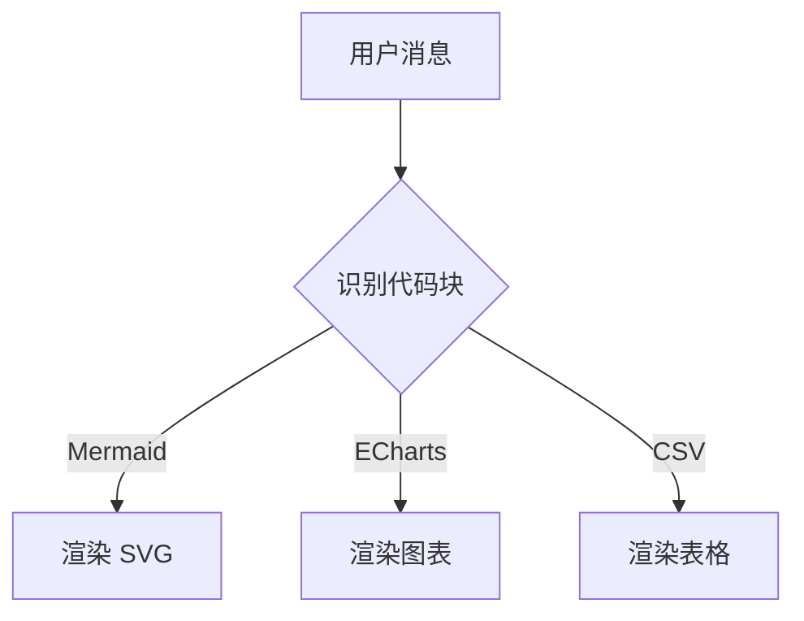

# dsh-render — DeepSeek Harness 渲染增强插件

一个本地 DSH 双半插件（Host + Web），把对话与文档预览中的围栏代码块渲染成：

- **Mermaid 图**：flowchart、sequence、class、state、ER、gantt、pie、mindmap、timeline、gitGraph、journey、quadrant、requirement、C4、sankey、xychart、block、packet、architecture、kanban、radar、treemap；
- **ECharts 图表**：代码块内容为 ECharts option JSON 时渲染为图表；
- **CSV 表格**：两行以上、列数一致的逗号分隔文本渲染为表格。

渲染在浏览器内完成，图表跟随 DSH 亮/暗主题，源码始终保留、一键切换查看。

> 设计说明见 [docs/DESIGN.md](docs/DESIGN.md)，内部接口契约见 [CONTRACT.md](CONTRACT.md)，第三方资源说明见 [docs/VENDOR.md](docs/VENDOR.md)。

## 功能

| 能力 | 说明 |
|---|---|
| Mermaid 渲染 | 识别 Mermaid 代码块并渲染为 SVG；主题跟随界面；流式稳定后渲染；错误兜底不吞内容 |
| ECharts 渲染 | 识别含 `series`/`xAxis`/`dataset` 等字段的 JSON；离屏渲染为 SVG 预览 |
| CSV 表格 | 解析引号/逗号/换行，渲染为可滚动表格 |
| 源码切换 | 每个图表卡片都有「查看源码 / 查看图表」按钮 |
| 交互 | 复制源码、下载 SVG、全屏查看（自动适应、滚轮/按钮缩放、拖拽平移、双击适应、ESC 关闭） |
| 主题 | 跟随 `body[data-ds-dark-theme]`，切换后自动重渲染 |
| 流式安全 | 文本停止变化 500ms 后再渲染，避免流式输出闪烁 |
| Markdown 外观 | 表格 Claude 风格（外框/圆角/表头浅灰底/行线加深/无悬停，字号跟随通用设置；所有表格强制适应会话宽度、列宽等分、允许单元格严重换行、不出现横向滚动）、行内 code Claude 灰底蓝字（加深 + 灰色描边，不加粗）、代码块边框、代码字体/字号/行高/连字（纯插件 CSS 覆盖，不改宿主） |
| 长用户消息折叠 | 超过阈值（默认 360px）的用户消息默认折叠，底部渐变 +「展开更多 / 收起」按钮，阈值可在设置页调整 |
| 设置页 | Settings → 渲染：逐类开关、Mermaid 主题、延迟、最大源码长度、检测策略、模型提示、Markdown 外观 |
| 可清理 | 禁用插件后移除所有增强、恢复源码显示、删除样式 |
| 零宿主改动 | 纯插件实现，不修改 DSH 源码、不重建 web 前端 |

## 安装

项目已包含 Mermaid 12.2.0 与 ECharts 6.1.0 的浏览器资源（`vendor/`），安装后即可离线使用。

在 Harness 的插件管理器中安装本地 bundle（target 为项目绝对路径）：

```text
plugin_manager action=install_bundle target=/home/zhaodan/work/NodeJsProjects/dsh-render
```

安装完成后刷新 Web 页面。插件会在 Settings 中增加「渲染」页面。

### 设置导航图标（宿主补丁）

DSH 的设置导航图标不能由插件注册，只能在宿主
`packages/client/ui-settings-general/src/client/SettingsRoot.tsx` 的 `navIcon(id)` 中按 section id 映射。
dsh-render 的 `render` 图标（画框 + 折线图 + 星芒）需要：

1. 在 `SettingsRoot.tsx` 中注册 `RenderNavIcon` 与 `navIcon('render')` 映射（见
   [docs/harness-client.patch](docs/harness-client.patch)，快照包含 dsh-skill / dsh-memory /
   dsh-instructions / dsh-render 的既有映射）；
2. 重建设置页 client bundle：

   ```bash
   cd ~/work/NodeJsProjects/deepseek-harness
   pnpm --filter @deepseek-ai/dsh-client-ui-settings-general bundle
   ```

3. 刷新 Web 页面（HMR 通常会在 0.5–1s 内检测到 bundle 变化）。

DSH 升级后若设置页导航图标回退成齿轮，按补丁快照重打并重建即可。

### 跨机器安装 / 迁移

插件是**自包含**的：无运行时 npm 依赖，Mermaid / ECharts 的浏览器资源随包提交，Host 半只用标准库与 DSH 服务。

**随包内容**：Host/Web 代码、`vendor/`（Mermaid 12.2.0 + ECharts 6.1.0）、`locale/`（插件页显示名）、`icon.svg`、测试、`docs/harness-client.patch`（宿主图标补丁快照）、`scripts/sync-vendor.mjs`。

**不随包内容**：

- `$DSH_HOME/dsh-render/settings.json`（用户设置；目标机器用默认值自动重建）；
- 目标 profile 的安装记录（需在目标机器重新 `install_bundle`）；
- 设置导航图标（依赖宿主 `SettingsRoot.tsx` 补丁，需在目标机器按快照重打并重建 `ui-settings-general`）。

**步骤**：

1. 拷贝整个 `dsh-render/` 目录，或使用 `pnpm pack` 生成的 tarball：

   ```bash
   cd ~/work/NodeJsProjects/dsh-render
   pnpm pack --pack-destination /tmp
   ```

2. 在目标机器安装（绝对路径或 tarball）：

   ```text
   plugin_manager action=install_bundle target=/path/to/dsh-render
   ```

3. 刷新 Web 页面；打开 Settings → 渲染，确认 Mermaid / ECharts 状态为「可用」。

4. 可选：设置导航图标。在目标机器的 deepseek-harness checkout 中按 `docs/harness-client.patch` 打补丁，然后重建：

   ```bash
   pnpm --filter @deepseek-ai/dsh-client-ui-settings-general bundle
   ```

5. 可选：重新同步 vendor：`node scripts/sync-vendor.mjs`。

**前提**：目标机器 DSH 版本满足 `engines.dsh`（`>=0.2.1-rc.2 <0.3.0`，与 0.2.1-rc.2 实测一致），并使用 Web profile。不满足时安装会以 `incompatible-version` 拒绝，而不是运行时静默失败。

## 使用

让模型输出 Mermaid 围栏即可：

````markdown

````

ECharts：

````markdown
```echarts
{
  "xAxis": { "type": "category", "data": ["Mon", "Tue", "Wed"] },
  "yAxis": { "type": "value" },
  "series": [{ "type": "bar", "data": [12, 20, 15] }]
}
```
````

CSV：

````markdown
```csv
name,count,note
alpha,12,first
beta,7,second
```
````

## 设置页

Settings → 渲染：

- 启用 Mermaid / ECharts / CSV；
- Mermaid 主题（跟随界面 / 浅色 / 深色）；
- 流式稳定延迟、最大源码长度；
- 内容启发式识别开关、额外 Mermaid 首行关键字；
- **Markdown 外观**：表格风格（Claude / DSH 原生）、行内代码（Claude 灰底蓝字 + 灰色描边 / 原生）、代码块风格（Claude / 极简 / 原生）、代码字体（跟随 DSH / 系统等宽 / JetBrains Mono / Fira Code / Cascadia Code / SF Mono / Consolas / Menlo / 自定义字体栈）、代码字号（0 = 跟随 DSH，12–20 覆盖）、行高（0 = 跟随，1.4–1.9 覆盖）、连字开关；长用户消息折叠（默认开）+ 折叠高度阈值（160–800px，默认 360px）。
- 向模型注入渲染提示（可选，默认关闭）；
- 资源状态（Mermaid / ECharts 版本与可用性）；
- 保存、恢复默认、重新读取。

设置保存在 `$DSH_HOME/dsh-render/settings.json`。

## 安全与隐私

- Mermaid 使用 `securityLevel: 'strict'`，不执行代码块中的脚本；
- ECharts 只接受 JSON，不执行函数/表达式；
- CSV 单元格全部 HTML 转义；
- vendor 资源只读、白名单、防路径穿越；
- 渲染纯客户端完成，不把对话内容发送到外部，也不写入磁盘。

## 项目结构

```text
dsh-render/
├── package.json            # @local/dsh-render（dsh.bundle + dsh.client）
├── cordis.patch.yml        # Host 行插入
├── index.js                # Host 半入口
├── lib/
│   ├── settings.js         # 设置默认值、归一化、原子存储
│   ├── vendor.js           # vendor 状态、路径安全、Content-Type
│   ├── routes.js           # /api/dsh-render/* 路由
│   └── prompt.js           # 可选系统提示段
├── client.js               # Web 半：DOM 增强 + 渲染器 + 设置页
├── vendor/
│   ├── mermaid/            # Mermaid 12.2.0（ESM + chunks）
│   └── echarts/            # ECharts 6.1.0（UMD）
├── locale/{zh,en}.json     # 插件页显示名（meta.title/description）；UI 字典内联在 client.js
├── icon.svg
├── docs/DESIGN.md
├── docs/VENDOR.md
├── CONTRACT.md
├── test/
└── scripts/sync-vendor.mjs # 重新同步 vendor 资源
```

## 开发

无构建、纯 JavaScript（Node 22+）：

```bash
node --check index.js client.js lib/*.js
node --test test/*.test.js
node scripts/sync-vendor.mjs   # 需要网络，重新同步 Mermaid/ECharts
```

## 已知限制

- Mermaid 通过首行图类型关键字识别（宿主 DOM 不暴露代码块语言）；可在设置中关闭启发式或补充关键字；
- ECharts 只接受 JSON option，不支持函数回调（如自定义 `formatter`）；
- CSV 为启发式识别，列数不一致或含明显代码特征时不渲染；
- 不渲染裸 HTML（安全考虑）；
- Markdown 外观是**纯插件 CSS 覆盖**（选择器锚定 `[data-chat-flow]`、`[data-document-markdown]`、`.md-code-block`），不改 DSH 源码；DSH 升级若调整这些标记需同步选择器；
- 代码字体只对系统已安装的字体生效（不内置 webfont），未安装时自动回退系统等宽。
- 用户消息折叠依赖 `[data-chat-flow-kind="user"]` 与 `[data-message-bubble]` 锚点；展开状态在消息重渲染/切换会话后恢复为默认折叠。
- Mermaid 首次加载按图类型懒加载 chunk，第一次渲染某种图会有短暂加载。

## 第三方资源

- [Mermaid](https://github.com/mermaid-js/mermaid) 12.2.0 — MIT
- [ECharts](https://github.com/apache/echarts) 6.1.0 — Apache-2.0

详见 [docs/VENDOR.md](docs/VENDOR.md)。
